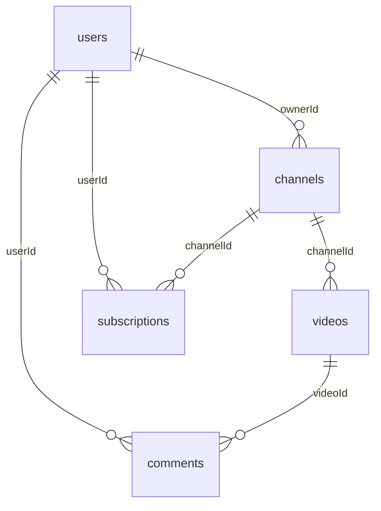

# Лабораторная работа 2: Аналог YouTube на MongoDB и Python

Учебная модель видеосервиса. MongoDB запускается через Docker Compose; все операции создания структуры, наполнения, запросов, агрегации и `explain` написаны на **Python с PyMongo**.

## 1. Состав проекта

| Файл | Назначение |
|---|---|
| `compose.yaml` | MongoDB и одноразовый контейнер Python |
| `Dockerfile`, `requirements.txt` | Python 3.12 и PyMongo |
| `scripts/01_setup.py` | Пять коллекций, `$jsonSchema`, связанные данные и индексы |
| `scripts/02_queries.py` | Пять поисковых запросов, CRUD, отказ валидации |
| `scripts/03_aggregations.py` | Агрегации, `$lookup`, аналитика |
| `scripts/04_explain.py` | Сравнение `explain` до и после создания индекса |
| `scripts/common.py` | Подключение к MongoDB и вывод результатов |

## 2. Запуск

Установите и запустите Docker Desktop или совместимый Docker Engine с Compose. В терминале перейдите в каталог с `compose.yaml` и выполните:

```bash
docker compose build app
docker compose up -d mongo
docker compose ps
docker compose run --rm app python /lab/scripts/01_setup.py
```

`01_setup.py` **удаляет только базу `video_lab`**, затем создаёт её заново. Это делает загрузку повторяемой. Если порт 27017 занят, измените левое число в `compose.yaml`, например `127.0.0.1:27018:27017`.

Дальше выполните демонстрации:

```bash
docker compose run --rm app python /lab/scripts/02_queries.py
docker compose run --rm app python /lab/scripts/03_aggregations.py
docker compose run --rm app python /lab/scripts/04_explain.py
```

PyMongo подключается к `mongodb://mongo:27017` внутри сети Compose. С компьютера можно открыть базу в MongoDB Compass по адресу `mongodb://localhost:27017`. Конфигурация предназначена для локальной учебной работы: порт доступен только на `127.0.0.1`, а аутентификация не настроена.

Проверка числа документов с помощью Python:

```bash
docker compose run --rm app python -c 'from common import connect; c,d=connect(); print({n:d[n].count_documents({}) for n in d.list_collection_names()}); c.close()'
```

## 3. Модель данных



| Коллекция | Основные поля | Связи |
|---|---|---|
| `users` | `username`, `email`, `joinedAt`, вложенный `profile`, массив `interests` | Пользователь владеет каналами, пишет комментарии и подписывается |
| `channels` | `ownerId`, `name`, `topic`, `createdAt`, вложенный `stats` | `ownerId` → `users._id` |
| `videos` | `channelId`, `title`, `category`, массив `tags`, `views`, `likes`, массив вложенных `chapters` | `channelId` → `channels._id` |
| `comments` | `videoId`, `userId`, `text`, `createdAt`, `likes` | Ссылки на видео и автора |
| `subscriptions` | `userId`, `channelId`, `createdAt`, `notificationsEnabled` | Ссылки на пользователя и канал |

**Embedding:** `users.profile`, `channels.stats` и `videos.chapters` хранятся внутри родительского документа, поскольку обычно читаются вместе с ним. **Referencing:** `ownerId`, `channelId`, `videoId` и `userId` ссылаются на документы других коллекций. MongoDB сама не обеспечивает внешние ключи, поэтому скрипт создаёт документы в порядке зависимостей.

Скрипт создаёт **12 пользователей, 12 каналов, 18 видео, 24 комментария и 24 подписки**. Все ссылки ведут на существующие демонстрационные документы.

## 4. Валидация

Для всех пяти коллекций применяется MongoDB `$jsonSchema` с `validationLevel="strict"` и `validationAction="error"`. Заданы `required` поля, (`bsonType`) и ограничения `minLength`, `minimum`, `enum`, `minItems`, шаблон email. Схемы находятся в `01_setup.py`.

`02_queries.py` пытается добавить пользователя без обязательного `email`, перехватывает `WriteError` и выводит код ошибки. Для отдельного скриншота можно выполнить:

```bash
docker compose run --rm app python /lab/scripts/02_queries.py
```

На экране найдите последний блок: напечатанный вызов `db.users.insert_one(...)` и ответ MongoDB с `code=121`.

## 5. Запросы и агрегации

`02_queries.py` показывает:

1. Поиск видео по одной категории.
2. Поиск по категории и диапазону просмотров через `$gte` и `$lt`.
3. Проекцию, сортировку и ограничение результата.
4. Поиск элемента массива `tags`.
5. Поиск по вложенному полю `profile.country` и массиву `interests`.
6. Добавление, изменение и удаление временного комментария. После выполнения основных данных становится столько же, сколько до запуска.

`03_aggregations.py` содержит четыре конвейера:

1. Количество видео и средние просмотры по категориям (`$match`, `$group`, `$sort`).
2. Видео вместе с каналом и владельцем канала (`$lookup` для `channels` и `users`, `$unwind`, `$project`, `$sort`).
3. Аналитика из пяти стадий: **какие категории дают больше лайков на 1000 просмотров?** (`$match`, `$project`, `$group`, `$sort`, `$limit`). Сначала вычисляется показатель для каждого ролика, затем среднее по категории. Каждый ролик имеет одинаковый вес.
4. Наиболее частые теги (`$unwind`, `$group`, `$sort`, `$limit`).

Скрипты печатают текст Python-запроса непосредственно перед его результатом. Для скриншотов откройте окно терминала шире и снимите соответствующий блок так, чтобы запрос и ответ читались одновременно.

## 6. Индексы и `explain`

| Индекс | Назначение |
|---|---|
| `videos: (category ASC, views DESC)` | Поиск видео категории с сортировкой по просмотрам |
| `comments: (videoId ASC, createdAt DESC)` | Последние комментарии к видео |
| `users: email`, уникальный | Быстрый поиск по email и запрет дублей |
| `subscriptions: (userId, channelId)`, уникальный | Запрет повторной подписки на канал |

`04_explain.py` временно удаляет `category_views_idx`, получает `explain` с `executionStats`, восстанавливает индекс и повторяет запрос с `hint`. `hint` заставляет MongoDB показать индексный план даже на очень маленькой учебной базе. Сравните `nReturned`, `totalDocsExamined`, `totalKeysExamined`, `winningPlan`. До индекса ожидается `COLLSCAN`, после — `IXSCAN` (обычно внутри `FETCH`). Время выполнения на 18 видео малоинформативно.

## 7. Повторение и остановка

```bash
docker compose run --rm app python /lab/scripts/01_setup.py
docker compose run --rm app python /lab/scripts/02_queries.py
docker compose run --rm app python /lab/scripts/03_aggregations.py
docker compose run --rm app python /lab/scripts/04_explain.py
docker compose down
```

`docker compose down` сохраняет данные в volume. Чтобы удалить и их, используйте `docker compose down -v`.
